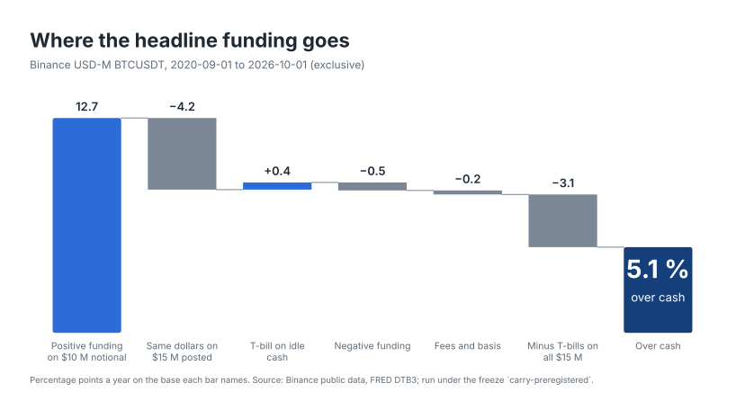
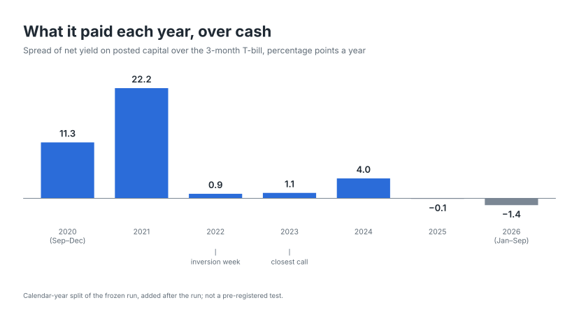

# perp-carry-economics

**BTC cash-and-carry on Binance paid 5.1 % a year over T-bills on the capital a desk has to post, September 2020 to September 2026, against a 12.7 % headline of positive funding.** Most of it was 2021: since 2022 the trade has paid about 1.0 point over cash. How it would be measured was frozen before the run.

<picture><source media="(prefers-color-scheme: dark)" srcset="results/figures/00_hero_dark.svg"></picture>

<picture><source media="(prefers-color-scheme: dark)" srcset="results/figures/01_yearly_spread_dark.svg"></picture>

The calendar-year split was added after the run; see [below](#added-after-the-run).

- Zero liquidations in six years at 4× margin with a four-hour top-up; closest call the week of 23 October 2023. The same book at 8× is liquidated 3 to 18 times, depending on how fast the desk tops up.
- Capacity about $78 M before the modelled spread halves; at $300 M the perp book cannot fill the position.
- Cutting the trade on negative funding cost 0.2 points a year, as the freeze predicted; 57 round trips, five times the fees. Only 5 of 73 months lost money; the risk was never the bad month, it was five years of earning cash while posting margin for it.

Parameters, rules, data hashes and the prediction were frozen on 2026-10-28, tag `carry-preregistered`, before the full period was run: [the freeze file](https://github.com/samuraixx-key/perp-carry-economics/blob/carry-preregistered/results/carry_freeze.json) and [the design it froze](https://github.com/samuraixx-key/perp-carry-economics/blob/carry-preregistered/docs/specs/2026-10-26-perp-carry-economics-design.md).

## Below the fold

### The inversion week (14 November 2022)

The frozen rule picks the calendar week with the lowest trailing 7-day (21-print) funding. The design expected October 2025; the rule picked the week after FTX failed. Over that week's 21 prints the book paid $4,520 in net funding on $10 M notional, needed no top-up, and its margin never fell below 48.9 % of notional against a 15 % trigger. Negative funding over the whole period comes in short stretches: 456 of them, 2.0 prints (16 hours) on average, the longest 18 prints (six days).

### One account, BTC as collateral (row A)

Holding the spot leg on the exchange as margin (Multi-Assets mode, BTC at a 5 % haircut) pays 5.5 % over cash, 0.5 points more than separate custody. It earns more funding ($8.05 M against $7.72 M) and more T-bill interest on idle cash ($0.47 M against $0.39 M), on the same $15 M. It is not the headline because the backtest cannot see what it risks: the whole position sits behind one exchange's solvency. Exchange default and collateral revaluation are not in the mark path.

### VIP 3 fees

The headline pays Binance regular-user taker rates. At VIP 3, the tier a $10 M book reset monthly reaches on its own volume (assuming at least 100 BNB held; no BNB discount modelled), fees over the period fall from $188,000 to $115,000 and the spread moves from 5.07 % to 5.15 %: 0.08 points. Fees do not decide this trade.

### Capacity

Capacity is modelled, not measured. The position is a permanent short share of open interest that moves every funding print (fitted on the top-trader position ratio), plus slippage walked through the USD-M book-depth files from 2023 onward; Binance publishes no spot depth, so the perp book stands in for the spot leg. Capacity is the size at which the modelled spread falls to half its value at $10 M, linear between grid points: about $78 M.

| Size | Modelled spread over cash | Book exhausted |
|---|---|---|
| $1 M | 5.0 % | no |
| $3 M | 5.0 % | no |
| $10 M | 4.7 % | no |
| $30 M | 4.0 % | no |
| $100 M | 1.6 % | no |
| $300 M | n/a | yes |
| $1,000 M | n/a | yes |

### Sensitivity: margin and top-up speed

Each setting is measured on its own capital, (1 + m0 + reserve) × $10 M, with the trigger at 0.6 × m0 and the reserve equal to m0. The primary setting is m0 25 %, τ 4 h. At 4× the only liquidation in the grid comes with a one-day top-up.

| τ (top-up latency) | m0 (leverage) | Capital | Liquidations | Top-ups | Spread over cash |
|---|---|---|---|---|---|
| 1 h | 12.5 % (8×) | $12.5 M | 3 | 144 | 4.9 % |
| 1 h | 25 % (4×) | $15 M | 0 | 72 | 5.1 % |
| 1 h | 50 % (2×) | $20 M | 0 | 33 | 3.6 % |
| 4 h | 12.5 % (8×) | $12.5 M | 7 | 132 | 3.5 % |
| **4 h** | **25 % (4×)** | **$15 M** | **0** | **71** | **5.1 %** |
| 4 h | 50 % (2×) | $20 M | 0 | 31 | 3.6 % |
| 24 h | 12.5 % (8×) | $12.5 M | 18 | 87 | 2.3 % |
| 24 h | 25 % (4×) | $15 M | 1 | 57 | 4.5 % |
| 24 h | 50 % (2×) | $20 M | 0 | 26 | 3.6 % |

### Limitations

- Reverse carry (short spot, long perp) needs a spot-borrow series Binance does not publish, so negative funding is carried, not traded.
- The coin-margined inverse perp with BTC as margin is the near-unliquidatable textbook form; it is not built because the liquidity sits in USD-M.
- dYdX has no spot leg and a BTC book two orders of magnitude smaller.
- Hyperliquid is a later phase: does the verdict survive on-chain.
- The 5 % BTC collateral haircut is the design's assumption, not checked against Binance at freeze; it touches only row A.
- The book is reset to $10 M at each month start. A drift band is what a desk more often does; monthly is simpler and its fee accounting cleaner.

### Added after the run

The calendar-year split (the second figure and `results/yearly.csv`) and the count of losing months were not in the freeze. They describe the frozen result and test nothing: no threshold hangs on them and nothing in the freeze is redefined. Each monthly sweep is counted in the month it closes, so the yearly nets add up to the full-period net; 2020 and 2026 are partial years.

### Method

Spot sits in custody and the short perp runs on USDC margin at 25 % of notional, topped up from a T-bill reserve when margin falls to 15 %, the top-up landing four hours later. Capital is 1.5 × $10 M notional, reset monthly, with anything above it swept out as return; every row uses the same $15 M and earns T-bills on its idle cash, so the headline is 8.2 % net on capital minus 3.1 % T-bills. The full design is in the [spec](docs/specs/2026-10-26-perp-carry-economics-design.md); where the engine differs from it or makes it precise is in its [§15 Amendments (as built)](docs/specs/2026-10-26-perp-carry-economics-design.md#15-amendments-as-built-2026-10-26).

## Reproduce

Run the steps in order from the repository root. `fetch`, `build` and `validate` take optional `--start` and `--end` (exclusive); the period defaults to 2020-09-01 up to the first day of the current month, so the current month is never requested. `--start` and `--end` only narrow the download and the bar table. The validation report always runs its engine checks on the fixed calibration window (2020-09-01 to 2020-12-01), and `pce run` takes its period from the freeze (or the calibration window), never from these flags. So `--start` must stay 2020-09-01 and `--end` at or after 2020-12-01; a later `--start` makes `validate` fail.

```bash
uv run pce fetch
```

Downloads the raw files into `data/raw/{funding,mark,spot,metrics,depth,fred}/`: monthly funding, mark-price and spot zips, daily metrics and bookDepth zips from data.binance.vision, plus one FRED CSV (DTB3). Several GB; bookDepth is most of it.

```bash
uv run pce build
```

Builds the minute bar table from the raw files.

```bash
uv run pce validate
```

Runs the data checks D1-D4 and the engine checks E1-E3, and writes the validation report.

```bash
uv run pce run
```

Runs every row, setting, episode and the capacity curve and writes `results/`. The run time is expected to be minutes but has not been measured.

```bash
uv run pce figures
```

Writes `results/yearly.csv` from the primary ledger and renders `results/figures/` in light and dark SVG. The yearly split was added after the run and is not part of the frozen record.

Reproducing a frozen run: pass `--end <frozen end>` (the freeze's `period.end`) to `fetch`, `build` and `validate`, so the raw files and the validation report cover exactly the frozen period; the default `--end` moves with today's date. `fetch` takes the T-bill series from `assets/DTB3.csv`, the copy pinned at freeze time, instead of downloading FRED's revised one. Extra raw files (a later month) do not block the run; a frozen file that is missing or differs does.

`pce run` without `--calibration` requires `results/carry_freeze.json` to exist and refuses to run if the inputs, rules or parameters differ from what it records; the code checks the file's contents, the input hashes, the rules and the parameters. The git tag on the freeze commit is an audit trail for the reader. `pce freeze --period-end YYYY-MM-DD` writes the freeze; it needs a passing validation report and refuses until `assets/binance_rules.json` has `"verified": true`, which you set yourself after checking the fee and tier snapshot.

For a quick look without a freeze, `pce run --calibration` runs 2020-09-01 to 2020-12-01 and writes `results/calibration/`:

```bash
uv run pce run --calibration
```

### One command

`pce all [--calibration] [--start DATE] [--end DATE]` runs fetch, build, validate and run in that order. `--calibration` applies to `run` only, so fetch, build and validate still cover the full period. The dates do not bound `run`: without `--calibration` its period comes from the freeze, and a mismatch with the bars built fails its coverage check; with `--calibration` it is the fixed calibration window.

The first full pass:

```bash
uv run pce all --calibration
# set "verified": true in assets/binance_rules.json after checking the snapshot
uv run pce freeze --period-end YYYY-MM-DD
git add results/carry_freeze.json assets/DTB3.csv
git commit -m "Pre-registration freeze" && git tag carry-preregistered
uv run pce run
```

`--period-end` is the exclusive end the validation report was written for: the first day of a month, after 2020-12-01 and no later than the first day of the current month (the default `--end` of the `pce all` just run). `pce freeze` refuses any other date, and refuses a validation report for another period. `pce all` without `--calibration` can only succeed once a freeze exists; it is for re-running a frozen pipeline (with `--end <frozen end>`).
